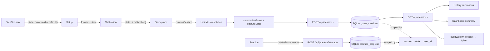
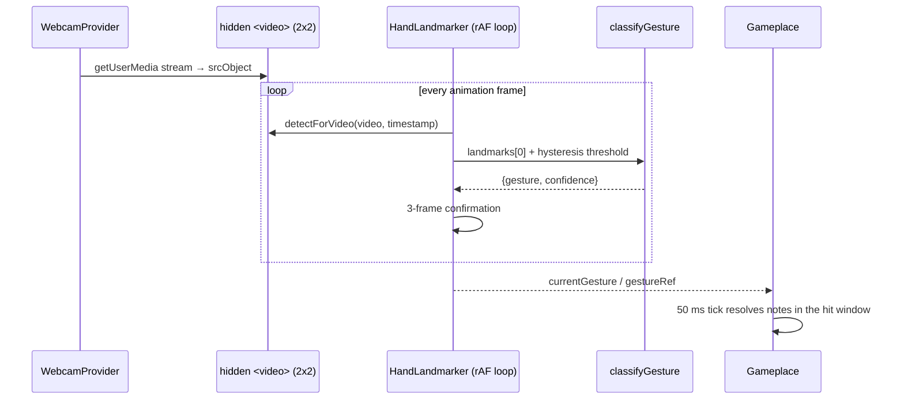

# Grip Restore — Feature Implementation Guide

How every user-facing feature is implemented, which files own it, and where the important logic lives.

- **Scope:** `frontend/` (game + UI) and `backend/` (auth, email verification, per-user persistence).
- **Status:** full-stack — real accounts, httpOnly cookie sessions, SQLite storage, email verification required before login.
- **Verification snapshot:** backend `npm test` 28/28, frontend `npm test` 38/38, `npm run lint` clean, `npm run build` OK. The earlier 26 auth/session checks and 13 account-management proxy checks were not re-run for this revision.

---

## Contents

1. [Overview](#1-overview)
2. [Architecture](#2-architecture)
3. [Feature walkthroughs](#3-feature-walkthroughs)
   - [F1 Auth](#f1-authentication)
   - [F2 Guarded routing, layout, transitions](#f2-guarded-routing-layout-and-page-transitions)
   - [F3 Dashboard](#f3-dashboard)
   - [F4 Session configuration](#f4-session-configuration)
   - [F5 Camera session](#f5-camera-session)
   - [F6 Hand tracking](#f6-hand-tracking)
   - [F7 Gesture classification](#f7-gesture-classification)
   - [F8 Calibration](#f8-calibration)
   - [F9 Gameplay engine](#f9-gameplay-engine)
    - [F10 Persistence and History](#f10-persistence-and-history)
    - [F11 Per-gesture session stats](#f11-per-gesture-session-stats)
    - [F12 Practice Mode](#f12-practice-mode)
    - [F13 Weekly forecast and plan](#f13-weekly-forecast-and-plan)
    - [F14 How to Play and first-run guide](#f14-how-to-play-and-first-run-guide)
4. [Backend, auth, and security](#4-backend-auth-and-security)
5. [Cross-cutting concerns](#5-cross-cutting-concerns)
6. [Testing and verification](#6-testing-and-verification)
7. [Known limitations](#7-known-limitations)
8. [Commit map](#8-commit-map)
9. [Constant reference](#9-constant-reference)

---

## 1. Overview

Grip Restore is a rehabilitation game for stroke survivors and arthritis patients. The webcam tracks hand landmarks; the player performs three grips (Pinch, Fist, Open Palm) that map to falling notes in a three-lane rhythm game. Sessions are scored, saved per user, and summarized as weekly progress.

### Stack

| Concern | Choice | Notes |
| --- | --- | --- |
| UI | React 19.2 | Hooks, `useEffectEvent` for interval callbacks |
| Build | Vite 8.2 | MediaPipe lazily split into `vision_bundle-*.js` |
| Routing | react-router-dom 7.18 | Nested routes + animated transitions |
| Animation | motion 13.1 | `AnimatePresence`, `MotionConfig reducedMotion="user"` |
| Hand tracking | `@mediapipe/tasks-vision` **1.1.0 (pinned)** | Runtime + model fetched from CDN |
| Styling | Hand-rolled CSS + tokens | No UI framework |
| API | Node 24 + Express 5 | Built-in `node:sqlite` (WAL), zod validation |
| Auth | scrypt + HMAC pepper, DB-backed cookie sessions | httpOnly, SameSite=Lax, 30-day sliding TTL |
| Email | nodemailer | SMTP when configured, console links in development |
| Tests | `node --test` | Pure modules + API integration; no DOM runner |

### Repository layout

```
Grip_Restore/
├─ backend/
│  ├─ src/
│  │  ├─ auth/                     # password hashing, tokens, sessions, requireAuth
│  │  ├─ db/                       # openDatabase + user_version migrations
│  │  ├─ http/cookies.js           # gr_session / __Host-gr_session
│  │  ├─ middleware/               # CSRF, rate limits, zod validation
│  │  ├─ routes/                   # auth.js, sessions.js, practice.js
│  │  ├─ validation/schemas.js     # strict request schemas
│  │  ├─ app.js / server.js / config.js / mailer.js
│  │  └─ data/                     # SQLite DB (gitignored)
│  ├─ test/                        # helpers + auth/sessions/practice/security suites
│  └─ .env.example
├─ docs/                           # this guide
└─ frontend/
   ├─ public/                      # icons.svg, logo.png
   └─ src/
      ├─ api/                      # fetch wrapper + auth/session calls
      ├─ components/               # shared UI (Navbar, WebcamCard, Charts, …)
      ├─ constants/sessionPaths.js # SESSION_PATHS
      ├─ context/                  # auth, webcam, hand-tracking providers + hooks
      ├─ data/                     # pure progress, forecast, guide logic (+ tests)
      ├─ game/                     # pure gameplay engine, gesture stats, sounds (+ tests)
      ├─ layouts/AppLayout.jsx
      ├─ pages/                    # one file per route (incl. Practice, WeeklyPlan)
      ├─ practice/                 # pure practice state machine + config (+ tests)
      ├─ styles/                   # tokens + per-page CSS
      └─ vision/                   # MediaPipe loader, classifier, skeleton renderer
```

### Scripts

| Command | Purpose |
| --- | --- |
| `npm run dev` | API (`:3001`) + Vite (`:5173`) via `concurrently` |
| `npm run dev:api` / `dev:web` | Run one side only |
| `npm run build` | Production frontend build to `frontend/dist/` |
| `npm run lint` | ESLint (`@eslint/js` + react-hooks + react-refresh) |
| `npm test` | Backend `node --test` suites, then frontend suites |
| `npm run install:all` | Install root, backend, and frontend dependencies |
| `npm --prefix frontend run preview` | Serve the production build |

---

## 2. Architecture

### Provider tree

```
main.jsx
└─ StrictMode
   └─ AuthProvider                     (GET /auth/me on boot; cookie session)
      └─ App
         └─ BrowserRouter
            └─ MotionConfig reducedMotion="user"
               └─ WebcamProvider       (single MediaStream)
                  └─ HandTrackingProvider (rAF detection loop)
                     └─ AnimatedRoutes (AnimatePresence + keyed Routes)
```

Sources: `frontend/src/main.jsx:15`, `frontend/src/App.jsx:103-115`.

**Why the camera providers sit above the routes:** `<Routes>` is keyed by `location.pathname` (`App.jsx:22`), so every navigation unmounts the previous page subtree. If the stream lived inside a page, Setup → Calibration → Game would re-prompt for camera permission and restart the feed. Hoisting `WebcamProvider` and `HandTrackingProvider` keeps one `MediaStream` and one rAF loop alive across the whole session.

The trade-off is that providers must release resources themselves. `WebcamProvider` stops tracks when the path leaves the session flow (`WebcamProvider.jsx:66-77`), and `HandTrackingProvider` stops its loop the same way (`HandTrackingProvider.jsx:248-252`).

### Routes

| Path | Element | Guard |
| --- | --- | --- |
| `/` | redirect → `/dashboard` | — |
| `/login` | `Login` | public |
| `/register` | `Register` | public |
| `/forgot-password` | `ForgotPassword` | public |
| `/reset-password?token=…` | `ResetPassword` | public |
| `/verify-email?token=…` | `VerifyEmail` | public |
| `/dashboard` | `Dashboard` | `RequireAuth` + `AppLayout` |
| `/start-session` | `StartSession` | `RequireAuth` + `AppLayout` |
| `/setup` | `Setup` | `RequireAuth` + `AppLayout` |
| `/calibration` | `Calibration` | `RequireAuth` + `AppLayout` |
| `/game` | `Gameplace` | `RequireAuth` + `AppLayout` |
| `/practice` | `Practice` | `RequireAuth` + `AppLayout` |
| `/plan` | `WeeklyPlan` | `RequireAuth` + `AppLayout` |
| `/instructions` | `Instructions` | `RequireAuth` + `AppLayout` |
| `/history` | `History` | `RequireAuth` + `AppLayout` |
| `/account` | `Account` | `RequireAuth` + `AppLayout` |
| `*` | redirect → `/dashboard` | — |

`SESSION_PATHS = ['/setup', '/calibration', '/game', '/practice']` (`constants/sessionPaths.js:1`) is the single source of truth for "camera should stay on". `AppLayout` also renders `FirstRunGuide`, which opens a native `<dialog>` once per user/browser.

### End-to-end data flow



### Tracking pipeline



### Session route state

There is no global session-config store. Configuration travels in React Router `location.state`:

1. `StartSession` → `/setup` with `{ durationMin, difficulty }` (`StartSession.jsx:83`)
2. `Setup` → `/calibration` forwarding `location.state` unchanged (`Setup.jsx:40`)
3. `Calibration` → `/game` merging `{ ...location.state, calibration }` (`Calibration.jsx:152-154`)

`Gameplace` validates what it receives and falls back to defaults: `SESSION_DURATIONS.includes(...)` for minutes, and `resolveDifficulty(...)` for difficulty (`Gameplace.jsx:145-151`). A direct `/game` visit therefore plays a valid 5-minute Easy session, but has no calibration data.

---

## 3. Feature walkthroughs

### F1 Authentication and email verification

**Goal:** real email/password accounts with server-enforced email verification and cookie sessions.

**Files (frontend):** `context/AuthProvider.jsx`, `api/client.js`, `api/auth.js`, `pages/Login.jsx`, `pages/Register.jsx`, `pages/ForgotPassword.jsx`, `pages/ResetPassword.jsx`, `pages/VerifyEmail.jsx`, `components/AuthLayout.jsx`, `components/Input.jsx`, `components/Checkbox.jsx`, `components/Button.jsx`.

**Files (backend):** `routes/auth.js`, `auth/password.js`, `auth/tokens.js`, `auth/sessions.js`, `auth/middleware.js`, `http/cookies.js`, `mailer.js`.

**Bootstrap**

- On mount, `AuthProvider` calls `GET /auth/me` with `credentials: 'include'`. `user` is `null` until this resolves; `loading` gates guarded routes (`AuthProvider.jsx`).
- Any `401` from `/auth/me` or `/api/*` dispatches a `gr:unauthorized` window event; the provider clears `user`, so an expired/revoked session redirects on the next guarded render (`api/client.js`).
- `login(email, password)` posts to `/auth/login`, stores the returned user, and navigates to `/dashboard`. `logout()` posts to `/auth/logout` and clears state even if the request fails.
- `logoutAll()` posts to `/auth/logout-all`, revokes every session (including the current one), and clears state. The Navbar exposes ordinary logout; `/account` exposes **Sign out of all devices**.

**Registration (verification required)**

1. The form validates name, email, password length (8–128), and confirmation locally.
2. `POST /auth/register` creates the user with `email_verified_at = NULL` and always responds generically (no account enumeration).
3. The UI shows a "Check your email" panel. In development it also renders the `devVerifyUrl` shortcut returned by the API.
4. The link opens `/verify-email?token=…`, which immediately posts the token and shows success or a clear "invalid/expired" state. Tokens are single-use, hashed at rest, and expire after 24 hours.
5. Login for an unverified account returns `403` with `code: "EMAIL_NOT_VERIFIED"`; the login page offers **Resend verification email** (`/auth/resend-verification`), which invalidates the previous token.

**Password recovery**

- `/forgot-password` posts an email; the response is always the same generic message (+ `devResetUrl` in development).
- `/reset-password?token=…` validates the new password, consumes the token (30-minute TTL), revokes **all** sessions, and asks the user to log in again.
- The reset page reads the token from the query string; `index.html` sets `<meta name="referrer" content="no-referrer">` so the token cannot leak through the `Referer` header.

**Account management (`/account`)**

- Profile card shows name, email, and verification status.
- **Change password** requires the current password, applies the same policy checks as registration/reset, rejects reusing the current password, and revokes every *other* session while keeping this device signed in (`POST /auth/change-password`, rate-limited).
- **Sign out of all devices** deletes every session row and clears the cookie (`POST /auth/logout-all`).

**Account protection**

- scrypt (N=2^15, r=8, p=1), 16-byte random salt, 64-byte key, HMAC-SHA256 pepper, `timingSafeEqual` comparison.
- Unknown emails still run a dummy scrypt verification so response timing does not reveal account existence.
- Five failed logins lock the account for 15 minutes; rate limits are applied per IP+email (IPv6 grouped by /64 via `ipKeyGenerator`).

**Edge cases:** expired/invalid verification token → actionable error, never a crash; network failure → `ApiError` with a friendly message; deliberately unauthenticated `/auth/me` → treated as signed out, not an error; reset/verify pages are public and never require a session.

---

### F2 Guarded routing, layout, and page transitions

**Files:** `components/RequireAuth.jsx`, `layouts/AppLayout.jsx`, `components/Navbar.jsx`, `components/PageTransition.jsx`, `App.jsx`.

- `RequireAuth` renders a full-page `Loading…` status while `AuthProvider` resolves `GET /auth/me`, then redirects unauthenticated users to `/login` with `state={{ from: location }}` (`RequireAuth.jsx`). This prevents the login page flashing before the cookie session is known.
- Authenticated pages render inside `AppLayout`: `Navbar` + `<Outlet />` + `FirstRunGuide` (`AppLayout.jsx`).
- Every page is wrapped in `PageTransition`, a motion div with enter/center/exit states: `opacity/x/scale`, 0.32 s, cubic-bezier `[0.4, 0, 0.2, 1]` (`PageTransition.jsx:3-17`).
- `AnimatePresence mode="wait"` plus `<Routes key={location.pathname}>` (`App.jsx:21-22`) ensures the old page finishes its exit animation before the new page mounts. This is also why each route gets a fresh component state on navigation — History re-reads storage on every visit.
- `MotionConfig reducedMotion="user"` (`App.jsx:106`) plus the global `prefers-reduced-motion` block (`tokens.css:104-112`) disable movement for users who request it.

**Consequence:** navigating away from `/game` via the Navbar unmounts the game without saving (see [Known limitations](#6-known-limitations)).

---

### F3 Dashboard

**Files:** `pages/Dashboard.jsx`, `components/StatCard.jsx`, `components/GestureCard.jsx`, `data/sessionStore.js`.

- Fetches the signed-in user's sessions once on mount with `GET /api/sessions`, then derives the weekly summary in a memo (`Dashboard.jsx`). A loading status and an inline error keep the page usable if the API is down.
- Greeting uses `userName` from the session context.
- Three stat cards: weekly accuracy with week-over-week caption, sessions completed vs. the goal of 8, and best streak in days (`Dashboard.jsx:31-52`).
- The "Start a session" card navigates to `/start-session` (`Dashboard.jsx:54-62`).
- The gesture strip is static presentation data, not read from the game engine.

All numbers are **derived**, never stored: `getWeeklySummary` is pure and accepts an injectable `now` for tests (`data/sessionStore.js`). The page holds only the API response.

---

### F4 Session configuration

**Files:** `pages/StartSession.jsx`, `game/fallingGame.js`, `game/session.js`, `styles/start-session.css`.

- Two durations: 5 and 10 minutes; default selection is **10** (`StartSession.jsx:21`).
- Three difficulties come from `DIFFICULTIES` in `fallingGame.js`; default is **easy** (`StartSession.jsx:22`, `fallingGame.js:44`).

| Difficulty | Fall time | Gap between notes | Hit window |
| --- | --- | --- | --- |
| Easy | 3000 ms | 2400–2800 ms | ±300 ms |
| Medium | 2200 ms | 1600–2000 ms | ±220 ms |
| Hard | 1600 ms | 1100–1400 ms | ±160 ms |

- Option buttons use `aria-pressed` to expose selection state.
- **Recommended difficulty:** on mount the page fetches `/api/sessions` and calls `getRecommendedDifficulty(rows)` (`data/sessionStore.js`). It averages the five most recent sessions: ≥85% nudges one level up, <60% one level down, otherwise it keeps the last chosen difficulty (capped at Hard). The suggestion preselects a button and is announced with a short reason; once the player taps a difficulty it is never overridden. With no history it suggests Easy. A failed fetch silently keeps the default.
- "Begin Session" passes both selections into route state.
- When arriving from `/plan`, `location.state` prefills duration and difficulty; a prefilled difficulty counts as an explicit pick, so the recommendation does not override the plan.
- `SESSION_DURATIONS = [5, 10]` and `DEFAULT_DURATION_MIN = 5` live in `game/session.js:1-2`; the game validates against that list so arbitrary state values cannot create a non-standard session (`Gameplace.jsx:145-147`).

---

### F5 Camera session

**Goal:** request the camera once, reuse it across the three session pages, and release it exactly when the session ends.

**Files:** `context/WebcamProvider.jsx`, `context/webcamContext.js`, `context/useWebcam.js`, `components/WebcamCard.jsx`, `styles` (`WebcamCard.css`, page styles).

**Status machine** (`webcamContext` consumers read `status`):

```
idle → requesting → active
                 ↘ denied | unsupported | error
```

- `start()` is idempotent: it returns early if a request is in flight or a stream already exists (`WebcamProvider.jsx:26-27`). It never auto-runs; pages call it on mount.
- `getUserMedia({ video: { facingMode: 'user' } })` on success stores the stream in a ref **and** state (`WebcamProvider.jsx:38-44`). The ref is what the release effects use, avoiding stale-closure reads.
- Errors map to `denied` for `NotAllowedError` / `PermissionDeniedError`, otherwise `error` with a message (`WebcamProvider.jsx:45-51`).
- `stop()` stops every track, clears refs/state (`WebcamProvider.jsx:14-24`).
- Leaving the session flow releases tracks and returns to `idle` inside a `queueMicrotask` to avoid a state update during the navigation render (`WebcamProvider.jsx:66-77`).
- Unmount also stops tracks (`WebcamProvider.jsx:57-64`).
- `WebcamCard` binds `stream` to a `<video>` through a ref + effect (`WebcamCard.jsx:50-56`), renders a mirrored preview via CSS (`scaleX(-1)`), and swaps in dedicated placeholders for `requesting`, `denied`, `unsupported`, `error`, `idle`. Retry buttons call the page-provided `onRetry` (`WebcamCard.jsx:82-119`).
- The card also registers its overlay `<canvas>` with the tracking provider so the skeleton is drawn onto the visible preview (`WebcamCard.jsx:58-63`).

**Glow variants:** `glow="teal|blue|purple|green"` selects one of the token shadows (`tokens.css:19-22`), used to highlight the current gesture.

---

### F6 Hand tracking

**Goal:** load MediaPipe only when needed, run one detection loop, expose flicker-free gesture state.

**Files:** `context/HandTrackingProvider.jsx`, `context/handTrackingContext.js`, `context/useHandTracking.js`, `vision/handLandmarker.js`, `vision/drawSkeleton.js`.

**Loading** (`handLandmarker.js`)

- `createHandLandmarker()` uses a **dynamic import** so the ~154 kB runtime is split out of the initial bundle (`handLandmarker.js:62`).
- WASM fileset and the float16 hand-landmarker model are fetched from jsDelivr / Google Storage, with the runtime version pinned to `1.1.0` in the URL (`handLandmarker.js:1-5`).
- User-facing timeout of **15 s** for both runtime and model creation; a late-resolving landmarker is closed rather than leaked (`handLandmarker.js:9-31`, `handLandmarker.js:69-85`).
- GPU delegate first; on a `/webgl|gpu|delegate/i` error it retries with the CPU delegate (`handLandmarker.js:33-36`, `handLandmarker.js:68-85`).

**Detection loop** (`HandTrackingProvider.jsx`)

- A hidden, 2×2, transparent `<video>` (inside the provider) is the detection source (`HandTrackingProvider.jsx:279-287`); the visible preview is a separate `<video>` bound directly to the stream.
- `detectHands` skips frames when the video is not ready, when `currentTime` has not advanced, or when the timestamp would be non-monotonic (`handLandmarker.js:94-103`).
- The rAF callback is created once and stored in `loopRef` (`HandTrackingProvider.jsx:77-163`) instead of being closed over per frame — this satisfies the react-hooks `immutability`/`refs` lint rules and keeps StrictMode remounts safe.
- Each frame: classify → update raw `gestureRef` → 3-frame confirmation → throttled state updates (`HandTrackingProvider.jsx:99-123`).
- FPS is measured over a 500 ms window and state-updated only when the integer changes (`HandTrackingProvider.jsx:10`, `HandTrackingProvider.jsx:150-157`).
- Overlay canvases are tracked in a `Set`; each frame resizes to `clientWidth/Height × min(devicePixelRatio, 2)` and redraws every registered skeleton (`HandTrackingProvider.jsx:133-149`).
- `startTracking()` is idempotent, deduplicates concurrent loads through `loadingRef`, and returns cached results when the landmarker already exists (`HandTrackingProvider.jsx:165-223`).
- `stopTracking()` cancels rAF, clears landmarks/canvases/gesture state, and resets public state in a microtask (`HandTrackingProvider.jsx:56-73`).

**Public contract** (`HandTrackingProvider.jsx:272-277`)

| Value | Meaning |
| --- | --- |
| `trackingStatus` | `idle` \| `loading` \| `active` \| `error` |
| `handsDetected` | boolean, per frame |
| `fps` | ~2 Hz integer readout |
| `currentGesture` | `pinch` \| `fist` \| `palm` \| `none`, **3-frame confirmed** (use this for UI/gameplay) |
| `gestureConfidence` | confidence for the confirmed gesture |
| `gestureRef` | raw per-frame `{gesture, confidence}` for low-latency readers |
| `startTracking` / `stopTracking` | lifecycle |
| `registerOverlay` / `unregisterOverlay` | canvas subscription |

**Debug badge:** `TrackingBadge` shows `fps · gesture confidence` (or `no hand`), loading, and an error state with an inline retry (`WebcamCard.jsx:14-43`). It uses `aria-live="off"` so it does not spam screen readers.

---

### F7 Gesture classification

**Files:** `vision/classifyGesture.js`, `vision/drawSkeleton.js`.

`classifyGesture(landmarks, threshold)` is a **pure, stateless** function over the 21 MediaPipe landmarks (`classifyGesture.js:52-94`).

**Normalization:** every threshold is a fraction of hand size `S = dist(wrist(0), middle-MCP(9))`, so the classifier works at any distance from the camera (`classifyGesture.js:58-62`).

**Validation:** the 12 indices actually read (`0, 4, 6, 8, 9, 10, 12, 14, 16, 17, 18, 20`) must exist with finite `x`/`y`; otherwise the result is `none` at 0.5 confidence. This prevents placeholder points such as `{}` from being counted as curled fingers (`classifyGesture.js:18-20`, `classifyGesture.js:53-57`).

**Decision priority** (`classifyGesture.js:64-93`):

1. **Fist** — at least 3 of 4 fingers curled (tip closer to the wrist than its PIP). Confidence 1.0 when all four are curled, 0.75 otherwise.
2. **Pinch** — `dist(thumb tip 4, index tip 8) < threshold × S`. Confidence measures how tight the pinch is, always against the *enter* threshold.
3. **Palm** — all four fingers extended **and** thumb extended (`dist(thumb tip, pinky MCP) > 0.8 × S`).
4. **None** — fallback at confidence 0.5.

Fist is checked first so a tight fist never misreads as a pinch.

**Hysteresis:** the caller passes `PINCH_ENTER_RATIO = 0.25` while pinch is inactive and `PINCH_EXIT_RATIO = 0.35` while it is active (`classifyGesture.js:12-13`, `HandTrackingProvider.jsx:100-104`). This prevents boundary chatter.

**Confidence contract:** confidence means *pose strength*, not label probability. A valid pinch at the release boundary reads `pinch@0.00`, while an absent hand reads `none@0.50`. Consumers must gate on gesture identity and hold time, never on a cross-gesture confidence threshold (`classifyGesture.js:36-51`).

**Skeleton rendering:** `drawHandSkeleton` maps normalized landmarks through the same `object-fit: cover` transform the preview uses, so the overlay stays aligned when the video is cropped; stroke width and dot radius scale with view width (`drawSkeleton.js:11-49`).

---

### F8 Calibration

**Files:** `pages/Calibration.jsx`, `styles/calibration.css`.

**Flow:** three steps — Pinch, Fist, Open Palm. Each step asks the user to hold the gesture for **2 seconds**.

- Constants: `HOLD_MS = 2000`, `TICK_MS = 100`, `NICE_MS = 600` (`Calibration.jsx:16-18`).
- `CalibrationStep` is keyed by gesture, so each step gets a fresh component and fresh hold counters (`Calibration.jsx:172-173`).
- A 100 ms interval runs only while tracking is `active` (`Calibration.jsx:71-78`). The tick is a `useEffectEvent`, so it always reads the latest `currentGesture` without re-creating the interval (`Calibration.jsx:46-69`).
- When the confirmed gesture matches: accumulate confidence samples and advance `heldMs` (capped at `HOLD_MS`). When it stops matching, all counters reset — the hold must be continuous.
- At 2 s the step shows "Nice!" for 600 ms, then reports `{ gesture, heldMs, meanConfidence, skipped: false }` (`Calibration.jsx:52-62`). `meanConfidence` is the rounded mean of per-tick confidences, or `null` if there were no samples.
- **Skip** is always available and reports the same shape with `skipped: true` and whatever hold progress existed (`Calibration.jsx:35-44`).
- Results are stored by step index; on the last step they are passed to `/game` as `calibration: [...]` merged with the existing route state (`Calibration.jsx:147-156`).
- The progress dots and hold bar expose `role="progressbar"` with min/max/now values (`Calibration.jsx:100-124`).

**Note:** calibration results are saved with the session but do not currently change gameplay; they are recorded for future personalization.

---

### F9 Gameplay engine

**Files:** `pages/Gameplace.jsx`, `game/fallingGame.js` (pure engine), `game/session.js` (shared constants), `game/sounds.js`, `styles/game.css`.

> **History:** `862d9f6` implemented a prompt-window engine (match a prompted gesture for a majority of a 4 s window). `cca5ed3` replaced it with the current falling-note engine. Only the current implementation is described here.

#### 9.1 Board model

Three fixed lanes, one per gesture. A note is a gesture sprite that spawns at the top of its lane, falls linearly, and must be matched when it crosses the hit line at **82%** of the lane height (`HIT_LINE_PROGRESS = 0.82`).

Each scheduled note carries absolute times (`fallingGame.js:69-86`):

| Field | Meaning |
| --- | --- |
| `spawnAtMs` | when the note appears at the top |
| `hitAtMs` | when it reaches the hit line |
| `bottomAtMs` | when it leaves the lane (`spawnAtMs + fallMs`) |

The board is a pure function of `elapsedMs`: `noteProgress` gives `0..1` from spawn to bottom with clamping (`fallingGame.js:91-97`), and `isNoteVisible` bounds rendering to `[spawnAtMs, bottomAtMs]` (`fallingGame.js:99-103`).

#### 9.2 Schedule generation

`createNoteSchedule({ difficulty, durationMs, rng })` (`fallingGame.js:60-89`)

1. Resolve difficulty config (unknown keys fall back to Easy).
2. The first note spawns after `LEAD_IN_MS = 700` ms and reaches the line after `fallMs × 0.82`.
3. Notes are appended while `hitAtMs <= durationMs`. The gap between hit times is `minGapMs + rng() × (maxGapMs − minGapMs)`, so spacing varies within the difficulty band.
4. Gestures come from `pickNextGesture(previous, rng)`, which never repeats the previous gesture; an unknown previous value falls back to the full set. The rng output is sanitized so a non-finite draw cannot produce `undefined` (`session.js:19-27`).
5. The schedule is generated **once** at play start and stored in both state and a ref (`Gameplace.jsx:228-246`), so no mid-session allocation happens.

Because the schedule is precomputed and monotonic, difficulty changes only affect fall speed, density, and timing strictness.

#### 9.3 Tick loop and resolution

- Tick interval: **50 ms** (`GAME_TICK_MS`, `fallingGame.js:4`). A test asserts it is smaller than the tightest hit window (`fallingGame.test.js:138-141`).
- The interval is created only when `canPlay && phase !== 'done'` (`Gameplace.jsx:336-340`), where `canPlay = camera active && tracking active` (`Gameplace.jsx:176`). Losing either effectively **pauses** the game; a "Game paused" overlay explains why (`Gameplace.jsx:106-111`).
- `onTick` is a `useEffectEvent` (`Gameplace.jsx:258-334`) so it reads current gesture/phase without being a dependency of the interval effect.
- Per tick:
  - **Ready phase:** decrement the countdown by 50 ms; emit one tick sound per whole second; start playing at zero (`Gameplace.jsx:261-271`).
  - **Playing:** advance `elapsedMs`, then walk the schedule once (`Gameplace.jsx:275-333`).
    - On the first tick after `spawnAtMs`, play the prompt sound.
    - Before `hitAtMs − hitWindowMs`: leave the note pending.
    - After `hitAtMs + hitWindowMs`: resolve as **miss**.
    - Inside the window: resolve as **hit** if `currentGesture === note.gesture`.
    - Only unresolved notes are considered; each note resolves at most once via `resolvedRef`.
  - If `elapsedMs >= durationMs`, finish the session.

Hit detection uses the **confirmed** `currentGesture` (3-frame stable), not the raw per-frame ref, which prevents single-frame misreads from scoring.

The render pass filters notes: resolved hits disappear; unresolved notes render only between spawn and bottom, with `progress` mapped to `top` percent (`Gameplace.jsx:349-359`).

#### 9.4 Difficulty rendering

- Hit band height is `hitWindowMs / fallMs × 200`, capped at 100% (`fallingGame.js:54-58`). All three presets produce a **20%** band, so the visual target stays consistent while the timings differ.
- The current gesture's target icon gets an `is-active` state, and lane head/target colors come from the gesture definitions (`Gameplace.jsx:50-90`).
- Feedback flashes "Nice!" or "Miss" for 650 ms with a nonce key to restart the animation (`Gameplace.jsx:30`, `Gameplace.jsx:92-96`, `Gameplace.jsx:202-210`).
- A hint appears when no hand is detected during play (`Gameplace.jsx:436-438`).

#### 9.5 Scoring and results

- `summarizeGame(hits, misses)` returns `{ hits, misses, attempted, accuracy }`, flooring negative/fractional inputs and guarding non-finite values (`fallingGame.js:119-129`).
- HUD: time left (`role="timer"`), hits, misses, accuracy, difficulty (`Gameplace.jsx:384-408`); a `role="progressbar"` session bar tracks elapsed time (`Gameplace.jsx:410-419`).
- Final overlay shows hits, misses, accuracy, difficulty, and duration (`Gameplace.jsx:113-133`).
- **Finish:** `saveCurrentSession(durationMin)` → phase `done` → finish sound → navigate to `/history` after 2600 ms (`Gameplace.jsx:31`, `Gameplace.jsx:248-256`).
- **Quit:** `saveCurrentSession(elapsedToDurationMin(elapsedMs))` → immediate `/history` (`Gameplace.jsx:342-347`). Quit duration rounds wall-clock time up to whole minutes with a 1-minute floor (`session.js:29-34`).
- Both paths save only if `attempted > 0` (`Gameplace.jsx:212-226`), so a countdown-only quit writes nothing. `endedRef` makes finish/quit single-shot.

#### 9.6 Sounds

`game/sounds.js` synthesizes everything with Web Audio — no audio assets.

- A single `AudioContext` with a master gain of 0.5 is created lazily (`sounds.js:14-23`).
- `initSounds()` is idempotent (StrictMode-safe) and installs one-shot `pointerdown`/`keydown` unlock listeners (`sounds.js:61-73`).
- `tone()` refuses to schedule on a context that is not `running`; otherwise queued tones would all fire at once when the context later resumes (`sounds.js:35-44`).
- Public cues: prompt 660 Hz / 90 ms, success 660→990 Hz, miss 220→165 Hz, countdown tick 440 Hz, finish arpeggio 523→659→784→1046 Hz (`sounds.js:75-116`).
- Every public function is wrapped so missing/blocked audio degrades silently.
- `disposeSounds()` exists for teardown but is intentionally not called on unmount, so the finish chime can ring while `/history` animates in (`sounds.js:118-133`).

---

### F10 Persistence and History

**Files:** `api/sessions.js`, `api/client.js`, `backend/src/routes/sessions.js`, `backend/src/db/migrate.js`, `data/sessionStore.js`, `pages/History.jsx`, `pages/Dashboard.jsx`, `components/Charts.jsx`, `styles/history.css`.

#### Storage model

Sessions live in the `game_sessions` table, scoped by `user_id` with an index on `(user_id, created_at)`. Migration v2 adds `gesture_stats` (JSON) for per-grip hits/misses. The frontend does not store progress in `localStorage`; only the first-run guide flag is device-local (keyed per user). Old browser-only accounts are **not** migrated — they never stored a password hash, so there is nothing to import into a real account.

#### Save path

`Gameplace` calls `createSession(payload)` (`api/sessions.js`) on finish or quit:

```js
{
  durationMin, difficulty, hits, misses,
  gesture: 'Mixed', gestures: [...],
  gestureStats: { pinch: { hits, misses }, fist: { ... }, palm: { ... } },
  calibration
}
```

- `Gameplace` updates an immutable `gestureStats` ref on every hit/miss (`game/gestureStats.js`) and resets it at play start.
- zod strict validation rejects unknown keys, unknown gestures, and out-of-range values (`validation/schemas.js`).
- `gestureStats` is optional; older clients/rows read as `{}` and the week plan simply ignores them.
- The server **recomputes accuracy** from `hits`/`misses` and ignores any client-supplied value (`routes/sessions.js`).
- Every insert uses `req.user.id` from the resolved session; the client cannot choose a user id.
- On failure the result overlay shows the API message. Finishing schedules the History navigation immediately; quitting awaits the save so the next page is fresh.

#### Session shape (API response)

```js
{
  id, dateISO, durationMin,
  gesture, gestures[], gestureStats,
  accuracy, difficulty, hits, misses,
  calibration
}
```

Rows stored before gameplay scoring still load: `hits`/`misses` are `null`, and History renders `—`.

#### Load path

`GET /api/sessions` returns the signed-in user's sessions newest-first (limit 1000). Dashboard and History fetch once per mount, show a loading status while the request is in flight, and surface an inline error without crashing. Because routes remount on navigation, finishing a session is visible immediately in History.

#### Derivations (pure, `now` injectable)

| Function | Behavior |
| --- | --- |
| `getSessionsPerWeek` | 7 Monday-start ISO week buckets, counts per week |
| `getAccuracyTrend` | Per-week mean accuracy; a week with no sessions **carries the previous value forward** |
| `getBestStreak` | Longest run of consecutive calendar days with at least one session |
| `getWeeklySummary` | Current-week accuracy, change vs. previous week, sessions completed, goal (8), best streak |
| `getSessionHistory` | Newest 6 sessions; `mode` = difficulty label → gesture → first gesture → `"Session"`; `hits`/`misses` rounded or `null` |

`weekIndexOf` clamps buckets to the 7 displayed weeks; sessions outside that window are ignored by charts. All functions are covered by `sessionStore.test.js`.

#### History page

- Fetches sessions once per mount, then derives all four datasets with `useMemo` (`History.jsx`).
- Three stat cards, with captions that branch on positive/negative accuracy change and on whether the weekly goal is met.
- **Charts are hand-rolled SVG**, `viewBox 600×220` (`Charts.jsx`):
  - `AccuracyTrendChart`: grid at 0/25/50/75/100, gradient area polygon, polyline, dots with `<title>` tooltips.
  - `SessionsBarChart`: y-scale is `max + 1`, rounded bars, value labels, `<title>` tooltips.
  - Both expose `role="img"` with descriptive `aria-label`s.
- Recent sessions list renders `—` for missing hits/misses (legacy rows).
- Empty state: "No sessions yet — complete your first session to start tracking progress."

---

### F11 Per-gesture session stats

**Files:** `game/gestureStats.js` (+ test), `pages/Gameplace.jsx`, `backend/src/db/migrate.js` (v2), `backend/src/validation/schemas.js`, `backend/src/routes/sessions.js`, `backend/test/sessions.test.js`.

- `createGestureStats()` returns zeroed counters for `pinch`, `fist`, and `palm`; `recordGestureResult(stats, gesture, result)` is pure and returns a new object, ignoring unknown gestures/results.
- `Gameplace` keeps the counters in a ref, updates them inside the 50 ms resolution loop for every hit/miss, resets them on play start, and includes them in the save payload.
- The API persists `gesture_stats` as JSON and returns `gestureStats` on every session. Validation uses a strict fixed-key object, so unknown gestures or negative counts are rejected. Legacy rows map to `{}`.
- Tests cover immutable counting, unknown inputs, validation failures, round-tripping, and legacy rows.

### F12 Practice Mode

**Files:** `practice/practiceConfig.js`, `practice/practiceEngine.js` (+ test), `pages/Practice.jsx`, `styles/practice.css`, `api/practice.js`, `backend/src/routes/practice.js`, `backend/src/db/migrate.js` (v3), `backend/test/practice.test.js`.

**Engine rules** (`tickPractice(state, gesture, deltaMs)`):

| Situation | Result |
| --- | --- |
| Target grip acquired | Attempt starts; status becomes `correct`; hold accumulates |
| Hold reaches 2000 ms | One success event; attempt/success/streak counters advance; bar stays full until release |
| Grip released or changed before 2000 ms | One failure event; current streak resets; best streak survives |
| No hand | `not-detected` |
| A different grip | `almost` |
| Same grip still held after success | No new attempt; release is required first |

- Constants: `PRACTICE_TICK_MS = 100`, `PRACTICE_HOLD_MS = 2000`, `PRACTICE_SUGGEST_AFTER_STREAK = 3` (`practiceConfig.js`).
- `Practice.jsx` runs the 100 ms interval only while tracking is active, uses `useEffectEvent` for the latest gesture, and posts completed attempts immediately.
- Saved progress loads from `GET /api/practice`; each POST returns the updated row. The sidebar displays all three grips, saved accuracy, current/best streak, and switches target without navigating.
- After three consecutive successes, a suggestion card offers `/start-session`; it is shown at most once per grip per visit (`suggestedRef` Set). Dismissing keeps the current streak going without repeating the prompt.
- The backend keeps one row per `(user_id, gesture)` with CHECK constraints, computes accuracy from counts, and scopes every query by `req.user.id` in a transaction. GET zero-fills all three grips; POST validates `{ gesture, success }` strictly.
- `/practice` is in `SESSION_PATHS`, so the camera stream and tracking loop stay alive while the user navigates into it, then stop on leave.

### F13 Weekly forecast and plan

**Files:** `data/analytics.js` (+ test), `pages/WeeklyPlan.jsx`, `styles/weekly-plan.css`, `pages/StartSession.jsx`, `pages/Practice.jsx`.

`buildWeeklyForecast(sessions, now)` is pure and returns summary cards, explanations, 7 day entries, and planned sessions.

| Rule | Behavior |
| --- | --- |
| Overall window | Last 5 valid sessions |
| Per-grip window | Last 3 sessions containing stats for that grip |
| Trend | Recent average minus previous 5-session average; forecast adjustment is half the delta, capped at ±5 points |
| Forecast | Recent average + adjustment, clamped 0–100; label `Likely strong` ≥85, `Likely steady` ≥70, `Likely mixed` ≥55, otherwise `Likely challenging` |
| Focus | Up to 2 grips below 75% with ≥3 attempts, lowest first; otherwise rotate all three |
| Difficulty up | ≥3 recent sessions, average ≥85, and all last three ≥80; steps up one level |
| Difficulty down | Recent average <60; steps down one level |
| Session count | 2 when recent average <60; 4 when the step-up readiness rule passes; otherwise 3 |
| Duration | 5 minutes for no data/low accuracy; 10 otherwise |
| Dates | Next 7 days from tomorrow; sessions on +1, +3, +5 and optionally +7 days |
| No data | 3 Easy 5-minute balanced sessions plus an explanation that the baseline will adapt |

- The plan page shows forecast/next-session, focus, and planned-session cards, an explanation list, and seven day cards with rest days. Session actions deep-link to `/start-session` with prefilled duration/difficulty (`StartSession` now reads route state) or `/practice` with the focus grip.
- Confidence is `high` for 5 recent sessions, `medium` for 3–4, `low` otherwise. The page explicitly presents forecasts as guidance, not a promised score.

### F14 How to Play and first-run guide

**Files:** `components/GuideContent.jsx`, `pages/Instructions.jsx`, `components/FirstRunGuide.jsx`, `data/guide.js` (+ test), `layouts/AppLayout.jsx`, `styles/guide.css`.

- `GuideContent` has six sections: camera setup, the three grips, a play session, practice, the weekly plan, and safety. It is reused at `/instructions` and in the modal.
- `FirstRunGuide` renders a native `<dialog>` (`showModal`) inside `AppLayout`, so it appears on the first authenticated page for a user. Escape and backdrop clicks dismiss it; the close button is focusable and labelled.
- Seen state is stored per user at `grip-restore:guide-seen:<userId>`. Storage reads/writes are wrapped in `try/catch`; if storage is unavailable the guide falls back to showing.
- “Read the full guide” marks the prompt seen and navigates to `/instructions`; “Got it” only dismisses. The navbar exposes **How to Play** at all times.
- Tests cover key namespacing, per-user isolation, and storage failure behavior.

---

## 4. Backend, auth, and security

### Runtime and configuration

- **Node 24 + Express 5**, ESM. The server opens SQLite through the built-in `node:sqlite` `DatabaseSync` (WAL, `foreign_keys = ON`, `busy_timeout`).
- `config.js` parses env once. In production it **fails closed** if `PASSWORD_PEPPER` is missing; development falls back to a known dev pepper.
- `server.js` loads `backend/.env` when present (`--env-file-if-exists`) and closes the DB on `SIGINT`/`SIGTERM`.
- Database path defaults to `backend/data/grip-restore.db` (ignored by git).

### Schema (migrations v1–v3)

`PRAGMA user_version` drives forward-only migrations (`db/migrate.js`).

| Table | Purpose | Notable constraints |
| --- | --- | --- |
| `users` | account + password hash | unique `email`, `email_verified_at`, `failed_login_count`, `locked_until` |
| `auth_sessions` | server-side sessions | hashed token, `user_id` FK, `expires_at`, `last_seen_at` |
| `email_verification_tokens` | one active verification token | SHA-256 hash, `expires_at` |
| `password_reset_tokens` | one active reset token | SHA-256 hash, `expires_at`, used timestamp |
| `game_sessions` | progress | `user_id` FK, index on `(user_id, created_at)`, `gesture_stats` JSON (v2) |
| `practice_progress` | per-grip practice totals | PK `(user_id, gesture)`, gesture CHECK, non-negative counters, FK cascade (v3) |

Foreign keys cascade on user deletion. Migration v2 adds `gesture_stats TEXT NOT NULL DEFAULT '{}'`; v3 creates `practice_progress` with attempts/successes/current/best streak and `updated_at`.

### Request lifecycle

1. `helmet` sets API-safe headers (CSP `default-src 'none'`, `frame-ancestors 'none'`, no-referrer, no `X-Powered-By`) and `Permissions-Policy: camera=(self)`.
2. CORS is restricted to `APP_ORIGIN` with credentials enabled.
3. JSON bodies are limited to **16 kB**; malformed JSON → `400`.
4. `csrfGuard` rejects unsafe methods whose `Origin`/`Referer` is missing in production or not in the allowlist.
5. Route-specific rate limiters run before validation (key: client IP + normalized email; IPv6 grouped by `/64` via `ipKeyGenerator`).
6. `validate(schema)` replaces the body with the parsed result, so handlers never see unvalidated fields.
7. `requireAuth` hashes the cookie token, resolves the session, checks expiry, slides the TTL when older than 15 days, and attaches `req.user`.
8. Handlers scope every query by `req.user.id`; errors are returned as `{ error, code? }` with no stack traces.

### Sessions and tokens

- Cookie `gr_session` in development; `__Host-gr_session` (requires `Secure`, `Path=/`, no `Domain`) in production. Always `HttpOnly`, `SameSite=Lax`, `Max-Age` 30 days.
- Session tokens are 32 random bytes; only their SHA-256 hash is stored. Maximum 10 sessions per user (oldest evicted).
- Verification and reset tokens are 32 random bytes, hashed at rest, single-use. Verification TTL 24 h, reset TTL 30 min. Resending invalidates the previous token; resetting revokes all sessions.
- Logout deletes the current session row and clears the cookie. Logout-all deletes every row for the user.
- Change-password verifies the current password, re-hashes with a fresh salt, and deletes all sessions whose token hash differs from the current one (the current device stays signed in).

### Passwords and lockout

- scrypt N=2^15, r=8, p=1; 16-byte salt; 64-byte key; HMAC-SHA256 pepper applied to the password before hashing.
- Login failures increment a counter; five failures set `locked_until = now + 15 min`. A successful login resets it.
- Unknown emails run a dummy hash comparison so timing stays flat.

### Email delivery

`mailer.js` uses nodemailer when `SMTP_HOST` is set. Otherwise it logs a `[mail:dev]` block with the full link. Register/forgot handlers include `devVerifyUrl`/`devResetUrl` only in development, which the UI renders as "Open link (dev)" shortcuts. Verification is still **required** in development.

---

## 5. Cross-cutting concerns

### Design system

- Single token sheet `styles/tokens.css`: background `#F4F8F8`, primary `#167D7F`, accent `#5B8DEF`, purple `#8175D5`, green `#3FAE7A`, ink `#263238` (`tokens.css:1-17`).
- Glow shadows per gesture (`tokens.css:19-22`), radii 10/16/25 px, spacing scale 4–48 px, minimum touch target 44 px, field height 56 px (`tokens.css:34-50`).
- Plus Jakarta Sans for display, Inter for body, with system fallbacks (`tokens.css:24-25`).
- Global focus ring: 3 px accent outline with offset (`tokens.css:98-102`).

### Accessibility

- Semantic landmarks (`main`, `header`, `nav`, `aside`), labeled nav (`Navbar.jsx:29`).
- Progress/status semantics: session progressbar, timer, calibration hold bar, feedback `role="status"`; the always-updating FPS badge is explicitly `aria-live="off"`.
- Selection state exposed with `aria-pressed` on option buttons.
- Charts use `role="img"` plus point-level `<title>` tooltips.
- Reduced-motion honored twice: `MotionConfig` and the global CSS media query.
- Decorative emoji/SVG marked `aria-hidden`.

### Resilience

- No-throw policy for storage, audio, landmarker close, and track stopping.
- Explicit camera states with retry affordances; explicit tracking error state with inline retry.
- 15 s network timeouts for MediaPipe assets with actionable messages.
- Frame skips guard against `detectForVideo` timestamp violations.
- Gameplay pauses instead of scoring while the camera or tracker is down.
- Invalid persisted data is rejected, not repaired.

### Performance

- MediaPipe runtime is a separate lazy chunk (`vision_bundle-*.js`, ~154 kB).
- One detection loop for the whole app; FPS state updates at ~2 Hz, and only on integer change.
- Canvas backing store clamped to 2× DPR.
- Gameplay schedule is precomputed; the 50 ms tick does O(pending notes) work with refs for hot counters, updating React state only on actual hits/misses (and once per tick for the clock).
- History derivations are memoized per mount; charts are static SVG.

### Lint-driven patterns

`eslint-plugin-react-hooks` 7.1.1 shaped several structures:

- Context objects/providers/hooks split into separate files to satisfy `react-refresh/only-export-components`.
- `useEffectEvent` used for tick callbacks in Gameplace and Calibration, keeping effects dependency-free without stale reads.
- rAF callback stored in `loopRef` (`HandTrackingProvider.jsx:75-163`) to satisfy `immutability`/`refs` rules.
- Provider state resets inside `queueMicrotask` to avoid `set-state-in-effect` warnings during navigation effects.

---

## 6. Testing and verification

### Automated

`npm test` at the root runs the backend suites (**28 tests**) and the frontend suites (**38 tests**).

| Suite | Coverage |
| --- | --- |
| `backend/test/auth.test.js` (13) | Register → verify → login, duplicate email, unverified login (`EMAIL_NOT_VERIFIED`), invalid credentials, logout, `/auth/me`, forgot/reset (including session revocation), resend invalidating the previous token, change-password (current-password check, other sessions revoked, current kept), logout-all, persistence across restart |
| `backend/test/sessions.test.js` (4) | Auth required; per-user isolation; server-recomputed accuracy; strict validation (including gesture stats); persisted ordering; legacy rows map to empty stats |
| `backend/test/practice.test.js` (3) | Auth + zero-filled stats; accuracy/streak updates and failure reset; validation + per-user isolation |
| `backend/test/security.test.js` (8) | Production cookie flags (`__Host-`, `Secure`, `HttpOnly`, `SameSite`); dev cookie; helmet/CSP headers; foreign-origin rejection; body-size limit; password pepper behavior; rate limiting; quoted emails treated literally (SQL injection); scrypt storage; registration validation |
| `frontend/src/game/fallingGame.test.js` (11) | Difficulty ordering and fallback; consistent 20% hit band; schedule lead-in, no repeated gestures, gaps within bounds; `noteProgress` clamping; visibility/hit/miss boundaries; summary math; tick < hardest window |
| `frontend/src/game/gestureStats.test.js` (3) | Zeroed lanes; immutable hit/miss counting; unknown gesture/result handling |
| `frontend/src/data/sessionStore.test.js` (10) | History mapping (difficulty/hits/misses/legacy rows); 7-week bucketing; carry-forward accuracy trend; weekly summary; best streak; Monday-start week; difficulty recommendation (new account, step up/down, hold, Hard cap, recency window); `formatDays` pluralization |
| `frontend/src/data/analytics.test.js` (6) | Baseline week; strong step-up and 4-session schedule; step-up guard on a dip; low-accuracy step-down/2 sessions; per-grip 3-session windows/focus; forecast date offsets and rest days |
| `frontend/src/data/guide.test.js` (2) | Per-user storage namespacing; unavailable-storage fallback |
| `frontend/src/practice/practiceEngine.test.js` (6) | Idle/almost states; exact 2 s success once; early release/wrong-grip failure and streak reset; release-before-next-attempt; 3-success suggestion threshold |

Backend tests spin up the real Express app on an ephemeral port against a temporary SQLite file (`backend/test/helpers.js`). Frontend tests use a fixed rng and injected `now`.

### End-to-end smoke (local, repeatable)

The prior revision's 26 auth/session checks and 13 account-management proxy checks were not re-run for this revision. The new practice and forecast behavior is covered by the automated suites above; the new pages still need a camera-enabled browser pass.

### Static

- `npm run lint` — ESLint recommended + react-hooks + react-refresh: clean.
- `npm run build` — Vite production build: OK, 506 modules, MediaPipe emitted as a separate chunk (`vision_bundle`, 153.90 kB).
- `npm test` — 28 backend + 38 frontend tests pass.

### Manual / browser-level (not automated)

These depend on a real camera and remain verified only by inspection:

- Countdown, falling notes, hit-line timing, lane feedback, and final session overlay.
- Sounds unlocking after a user gesture and cue timing.
- Live skeleton alignment on the mirrored, cropped preview.
- Calibration hold progress and skip handoff.
- Save-on-finish / save-on-quit appearing as the top row in History.
- Practice hold bar, early-release failure, streak reset, saved progress refresh, and the once-per-grip-after-3-successes suggestion.
- Per-gesture stats reaching History's API rows and the weekly forecast.
- Forecast day cards deep-linking into a prefilled Start Session and focused Practice.
- First-run `<dialog>` appearing only until dismissed, Escape/backdrop dismissal, and the full guide rendering at `/instructions`.
- StrictMode double-mount behavior and responsive breakpoints (900 px / 640 px / 700 px).

---

## 7. Known limitations

| Area | Limitation |
| --- | --- |
| Email | Without SMTP, links only appear in the API console (and as dev shortcuts in the UI). No background retry queue. |
| Rate limits | Login/register/recovery counters and account lockouts are in-memory; they reset on restart and are not shared across instances. |
| Session cleanup | Expired session/token rows are ignored but not periodically deleted; cleanup happens lazily. |
| Account recovery | A known email can be locked out by five failed attempts (accepted trade-off). |
| Account settings | No change-email or delete-account flow; password changes are supported from `/account`. |
| Abandonment | Leaving `/game` via the Navbar or browser back unmounts the game without saving. Only "Quit session" saves partial progress. |
| Refresh | Refreshing `/game` loses duration/difficulty/calibration route state and restarts with defaults (5 min, Easy, no calibration). |
| Quit duration | Wall-clock based, so paused time is included; minimum 1 minute. |
| Calibration | Results are persisted but do not influence gameplay yet. |
| Practice | Attempts count only after the target grip is acquired; time with no hand is ignored. There is no undo for an accidental attempt. |
| Forecast | Directional guidance, not a clinical prediction. It needs saved sessions and only per-gesture data from sessions recorded after migration v2. |
| Weekly plan | Dates are local and start tomorrow; plans do not auto-reschedule if a day is skipped. |
| First-run guide | Seen state is per browser profile, not synced across devices. |
| Tracking health | If the camera stream stalls while `trackingStatus` still reports `active`, notes can miss. There is no stream-level health signal. |
| Auth redirect | `RequireAuth` passes `state.from`, but Login still redirects to `/dashboard`. |
| Accessibility testing | Semantics are implemented, but no screen-reader or axe audit has been run. |
| Tests | No DOM/component tests in CI; API behavior is covered by integration tests and the documented e2e smoke script. |
| Runtime | `node:sqlite` is experimental in Node 24; node warnings are suppressed by the npm scripts. |

---

## 8. Commit map

| Commit | Feature |
| --- | --- |
| `e99d010` | Frontend prototype with persistent webcam session |
| `5c7abbd` | MediaPipe hand-tracking foundation + skeleton overlay |
| `b3ecb4e` | Rule-based gesture classification + live badge |
| `d56d4e9` | Calibration: hold-to-confirm with skip and results handoff |
| `c55d15c` | Per-user client-side persistence with seeded histories |
| `95b553c` | Fix: new accounts start with empty history (no seeding) |
| `862d9f6` | Prompt-window gameplay engine (superseded) |
| `cca5ed3` | Falling-gesture gameplay, difficulty, scoring, tests |
| `ed78b5e` | Backend API, secure auth, email verification, reset flow, server-backed sessions |
| `e103e19` | Per-gesture accuracy stored with game sessions |
| `2a9def2` | Per-gesture Practice Mode with saved progress |
| `17ab1bd` | Play-session suggestion after practice success |
| `54ef75c` | Explainable weekly session forecast/plan |
| `638b31d` | How to Play page and first-run guide |
| _pending_ | **Current** — docs update for practice, forecasts, and guide |

---

## 9. Constant reference

| Constant | Value | Where |
| --- | --- | --- |
| `SESSION_PATHS` | `['/setup', '/calibration', '/game', '/practice']` | `constants/sessionPaths.js:1` |
| `SESSION_DURATIONS` | `[5, 10]` minutes | `game/session.js:1` |
| `DEFAULT_DURATION_MIN` | `5` | `game/session.js:2` |
| `GESTURES` | pinch / fist / palm (colors `#5B8DEF`, `#8175D5`, `#3FAE7A`) | `game/session.js:5-9` |
| `READY_MS` | `3000` | `game/fallingGame.js:3` |
| `GAME_TICK_MS` | `50` | `game/fallingGame.js:4` |
| `HIT_LINE_PROGRESS` | `0.82` | `game/fallingGame.js:5` |
| `LEAD_IN_MS` | `700` | `game/fallingGame.js:6` |
| `DEFAULT_DIFFICULTY` | `'easy'` | `game/fallingGame.js:44` |
| Recommendation window | last `5` sessions | `data/sessionStore.js` |
| Recommendation thresholds | `≥85%` up, `<60%` down | `data/sessionStore.js` |
| Hit window / fall time | Easy 300/3000, Medium 220/2200, Hard 160/1600 ms | `game/fallingGame.js:8-42` |
| `PINCH_ENTER_RATIO` / `PINCH_EXIT_RATIO` | `0.25` / `0.35` | `vision/classifyGesture.js:12-13` |
| `GESTURE_CONFIRM_FRAMES` | `3` | `context/HandTrackingProvider.jsx:11` |
| `FPS_WINDOW_MS` | `500` | `context/HandTrackingProvider.jsx:10` |
| MediaPipe load timeout | `15000` ms | `vision/handLandmarker.js:7` |
| Calibration `HOLD_MS` | `2000` ms | `pages/Calibration.jsx:16` |
| Practice hold | `2000` ms | `practice/practiceConfig.js` |
| Practice tick | `100` ms | `practice/practiceConfig.js` |
| Practice suggestion streak | `3` successes | `practice/practiceConfig.js` |
| Forecast overall window | last `5` sessions | `data/analytics.js` |
| Forecast per-grip window | last `3` sessions | `data/analytics.js` |
| Weak-grip rule | `<75%` with `≥3` attempts, max `2` grips | `data/analytics.js` |
| Forecast trend cap | `±5` points (half the delta) | `data/analytics.js` |
| Plan days | `+1, +3, +5, +7` from tomorrow | `data/analytics.js` |
| Guide storage | `grip-restore:guide-seen:<userId>` | `data/guide.js` |
| `RESULT_NAV_MS` | `2600` ms | `pages/Gameplace.jsx:31` |
| `FEEDBACK_MS` | `650` ms | `pages/Gameplace.jsx:30` |
| Weekly goal | `8` sessions | `data/sessionStore.js:6` |
| Weeks shown | `7` | `data/sessionStore.js:2` |
| History rows | `6` | `data/sessionStore.js:3` |
| Session TTL | `30` days (renew after `15`) | `backend/src/config.js` |
| Max sessions per user | `10` | `backend/src/config.js` |
| Reset token TTL | `30` minutes | `backend/src/config.js` |
| Verification token TTL | `24` hours | `backend/src/config.js` |
| Login lockout | `5` failures → `15` minutes | `backend/src/config.js` |
| Login rate limit | `10` / 15 min per IP+email | `backend/src/config.js` |
| Register / recovery rate limit | `5` / hour each | `backend/src/config.js` |
| scrypt parameters | `N=2^15, r=8, p=1`, 16-byte salt, 64-byte key | `backend/src/auth/password.js` |
| JSON body limit | `16 kb` | `backend/src/app.js` |
